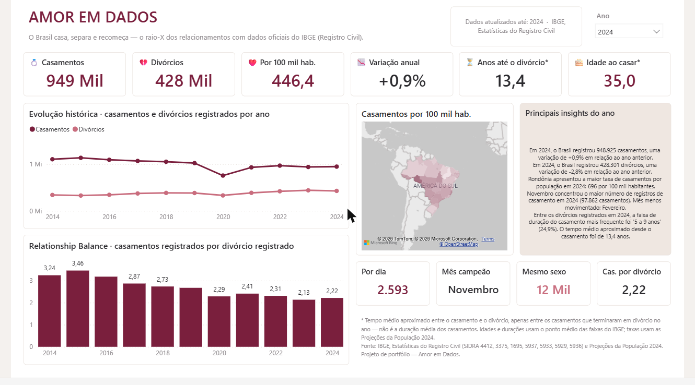
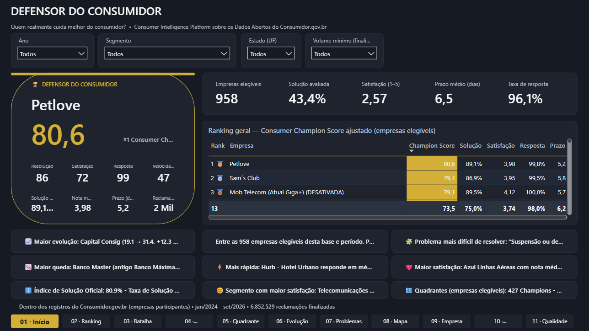
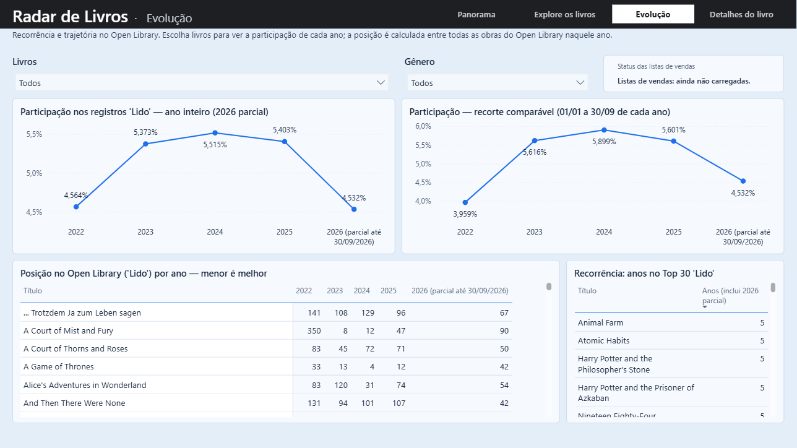
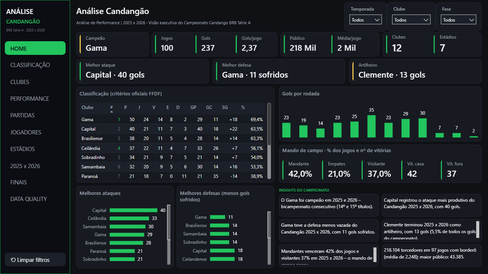
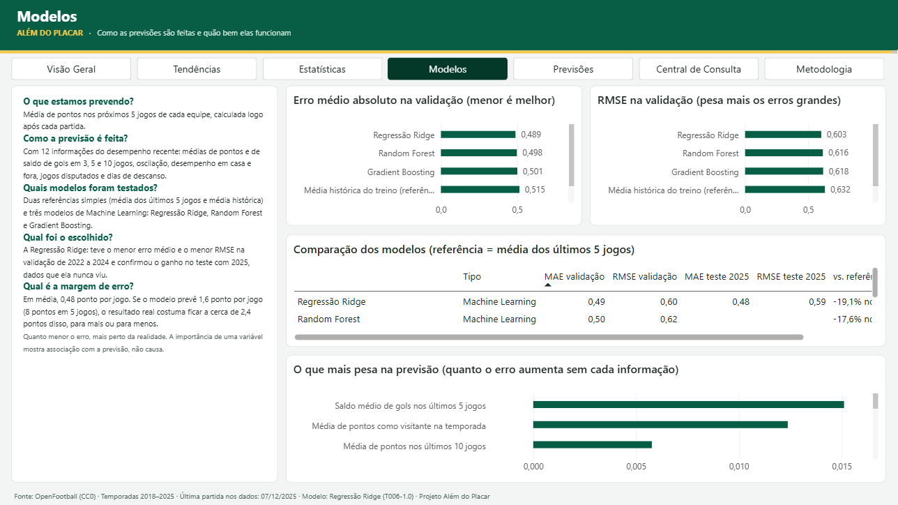
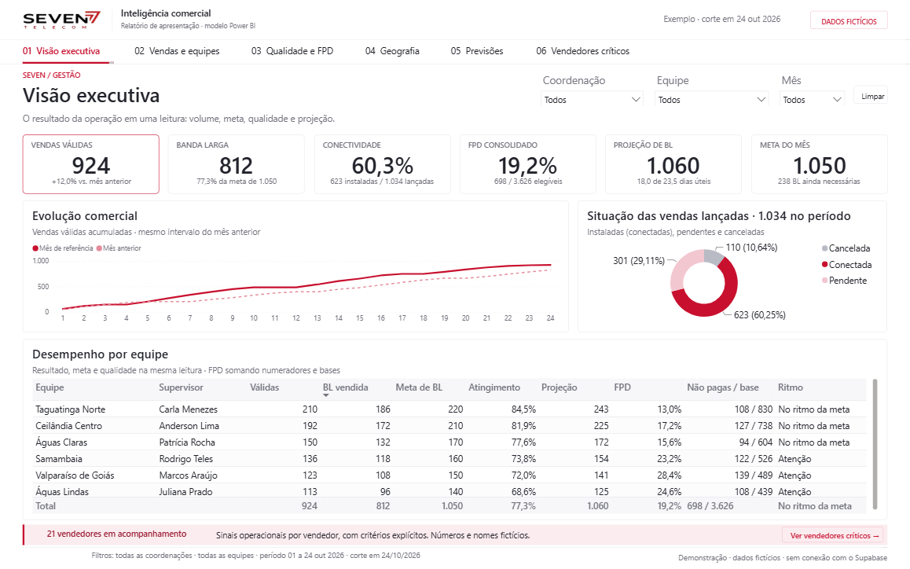
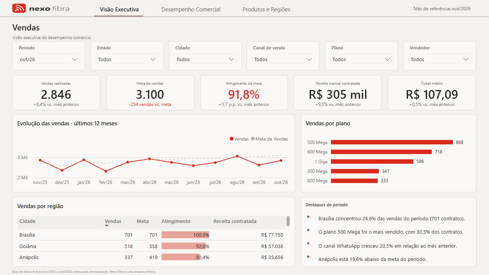
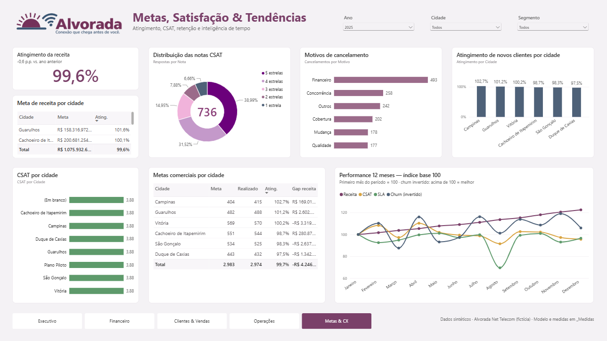

# Dashboards de Power BI

Dashboards que construí em Power BI, do tratamento dos dados no Power Query à modelagem e às medidas em DAX. Todos estão publicados na web e abrem no navegador, sem login.

Os projetos com dados públicos indicam a fonte. Os de negócio usam bases fictícias ou versões anonimizadas: nenhum dado real de cliente aparece aqui.

## Índice

| Dashboard | Fonte dos dados | Páginas | Link |
|---|---|---|---|
| [Amor em Dados](#amor-em-dados) | IBGE · Registro Civil / SIDRA e Projeções da População 2024 | 12 | [Abrir ↗](https://app.powerbi.com/view?r=eyJrIjoiMDUyNWU5ZWEtYTRhYy00NGZlLWE3NDAtZThkOWQwMzBkNzkzIiwidCI6IjY1OWNlMmI4LTA3MTQtNDE5OC04YzM4LWRjOWI2MGFhYmI1NyJ9) |
| [Defensor do Consumidor](#defensor-do-consumidor) | Consumidor.gov.br · Dados abertos | 11 | [Abrir ↗](https://app.powerbi.com/view?r=eyJrIjoiMDUyZDhiOWUtMjA2MS00NzFiLTlhMTItZTQ1YTU1ZmEyODViIiwidCI6IjY1OWNlMmI4LTA3MTQtNDE5OC04YzM4LWRjOWI2MGFhYmI1NyJ9) |
| [Radar de Livros](#radar-de-livros) | Open Library / Internet Archive · Dados abertos | — | [Abrir ↗](https://app.powerbi.com/view?r=eyJrIjoiODEzYmMzMDItZDAyNS00MTk1LTg4ZjUtZmZhOGI4Yjk3ZTFiIiwidCI6IjY1OWNlMmI4LTA3MTQtNDE5OC04YzM4LWRjOWI2MGFhYmI1NyJ9) |
| [Candangão](#candangão) | FFDF · Súmulas e borderôs oficiais | 13 | [Abrir ↗](https://app.powerbi.com/view?r=eyJrIjoiYjRjMjc4NjktZjI0Mi00YmY5LTgwODUtN2FjYjk4MzZlYzNmIiwidCI6IjY1OWNlMmI4LTA3MTQtNDE5OC04YzM4LWRjOWI2MGFhYmI1NyJ9) |
| [Além do Placar](#além-do-placar) | OpenFootball (CC0) · Wikipédia/Wikimedia | 7 | [Abrir ↗](https://app.powerbi.com/view?r=eyJrIjoiZGJhMmY5MDEtNzg1My00ZjYwLTljNjItZTAyZTRlNGJmOTAyIiwidCI6IjY1OWNlMmI4LTA3MTQtNDE5OC04YzM4LWRjOWI2MGFhYmI1NyJ9) |
| [Seven Telecom](#seven-telecom) | Operação real · Versão pública com dados fictícios | — | [Abrir ↗](https://app.powerbi.com/view?r=eyJrIjoiY2UwYTFlYjUtMDZiMy00NzVkLTkxMmEtYjQxM2RkYWZkZWRiIiwidCI6IjY1OWNlMmI4LTA3MTQtNDE5OC04YzM4LWRjOWI2MGFhYmI1NyJ9) |
| [Nexo Fibra](#nexo-fibra) | Base simulada · Dados fictícios | 3 | [Abrir ↗](https://app.powerbi.com/view?r=eyJrIjoiN2ZhMjZkOTctYjUxMi00Y2Q1LWIzYjAtZjQ2YmExMWMwOTc5IiwidCI6IjY1OWNlMmI4LTA3MTQtNDE5OC04YzM4LWRjOWI2MGFhYmI1NyJ9) |
| [Alvorada Net](#alvorada-net) | Base simulada · Dados fictícios | 5 | [Abrir ↗](https://app.powerbi.com/view?r=eyJrIjoiZTc3ZmE2NDYtY2ZlNS00YmE2LTgxYzctNGFkMmVmMzFjY2RmIiwidCI6IjY1OWNlMmI4LTA3MTQtNDE5OC04YzM4LWRjOWI2MGFhYmI1NyJ9) |

## Com dados públicos

### Amor em Dados

Um raio-X dos casamentos e divórcios no Brasil de 2014 a 2024, com 12 páginas, tendências, sazonalidade e diferenças regionais.

**Contexto.** Registros civis oficiais e projeções populacionais do IBGE, com comparações por ano e unidade da federação.

**Objetivo.** Entender quando e onde os brasileiros se casam e se divorciam, sem confundir volume absoluto com taxa populacional.

**Destaques**

- Série histórica, tendência linear e média móvel.
- Heatmap de sazonalidade por ano e mês.
- Comparador de UFs com dimensão desconectada e TREATAS.
- Índices exploratórios, metodologia e limitações documentadas.

**Ferramentas:** Power BI · DAX · Power Query · Modelagem dimensional  
**Fonte:** IBGE · Registro Civil / SIDRA e Projeções da População 2024 · **Páginas:** 12

**[Explorar dashboard ↗](https://app.powerbi.com/view?r=eyJrIjoiMDUyNWU5ZWEtYTRhYy00NGZlLWE3NDAtZThkOWQwMzBkNzkzIiwidCI6IjY1OWNlMmI4LTA3MTQtNDE5OC04YzM4LWRjOWI2MGFhYmI1NyJ9)**

### Defensor do Consumidor

Análise comparativa de empresas no Consumidor.gov.br, com ranking, evolução, mapa, segmentos e auditoria da base.

**Contexto.** 6.852.529 reclamações finalizadas entre janeiro de 2024 e setembro de 2026 e 958 empresas elegíveis.

**Objetivo.** Comparar resolução, satisfação, resposta e velocidade sem premiar empresas por amostras pequenas.

**Destaques**

- Consumer Champion Score: pesos 40%/30%/20%/10%.
- Ajuste de componentes por média bayesiana (k = 100).
- Ranking, comparação de marcas e quadrante da excelência.
- Reconciliação de arquivos e sete controles de qualidade (DQ01–DQ07).

**Ferramentas:** Power BI · DAX · Power Query · ETL  
**Fonte:** Consumidor.gov.br · Dados abertos · **Páginas:** 11

**[Explorar dashboard ↗](https://app.powerbi.com/view?r=eyJrIjoiMDUyZDhiOWUtMjA2MS00NzFiLTlhMTItZTQ1YTU1ZmEyODViIiwidCI6IjY1OWNlMmI4LTA3MTQtNDE5OC04YzM4LWRjOWI2MGFhYmI1NyJ9)**

### Radar de Livros

_Na imagem: página Evolução._

Quais livros mais aparecem nas estantes dos leitores: rankings anuais, evolução ano a ano e ficha completa de cada edição, de 2022 a 2026.

**Contexto.** Marcações de “Lido” e “Quero ler” da comunidade Open Library (majoritariamente de língua inglesa), com dados até 30/09/2026. Não é ranking de vendas nem do mercado brasileiro.

**Objetivo.** Separar sucessos passageiros de livros constantes e permitir explorar qualquer título por gênero, público, idioma e autor.

**Destaques**

- Coleta via API pública e limpeza de ~410 mil marcações automáticas que distorciam 2026.
- Recorte comparável de janeiro a setembro para comparar anos incompletos.
- Posição ano a ano e recorrência no Top 30.
- Ficha do livro com sinopse, ISBN, editora e outras edições, priorizando a edição em português; capas validadas uma a uma.

**Ferramentas:** Power BI · DAX · Power Query · API REST · Modelagem  
**Fonte:** Open Library / Internet Archive · Dados abertos

**[Explorar dashboard ↗](https://app.powerbi.com/view?r=eyJrIjoiODEzYmMzMDItZDAyNS00MTk1LTg4ZjUtZmZhOGI4Yjk3ZTFiIiwidCI6IjY1OWNlMmI4LTA3MTQtNDE5OC04YzM4LWRjOWI2MGFhYmI1NyJ9)**

### Candangão

Performance do Campeonato Candango BRB Série A, edições 2025 e 2026: classificação, ataque, defesa, torcida, estádios e jogadores.

**Contexto.** 100 partidas, 237 gols, 12 clubes e dados de público presentes em 97 borderôs.

**Objetivo.** Comparar temporadas, clubes e jogos respeitando os critérios oficiais da competição.

**Destaques**

- Classificação por rodada com critérios oficiais da FFDF.
- Quadrantes de ataque e defesa e índices IFO/ISD.
- Comparação 2025 × 2026, incluindo evolução de clubes.
- Auditoria de gols, resultados e duplicidades; drill-through em três níveis.

**Ferramentas:** Power BI · DAX · Power Query · Modelagem  
**Fonte:** FFDF · Súmulas e borderôs oficiais · **Páginas:** 13

**[Explorar dashboard ↗](https://app.powerbi.com/view?r=eyJrIjoiYjRjMjc4NjktZjI0Mi00YmY5LTgwODUtN2FjYjk4MzZlYzNmIiwidCI6IjY1OWNlMmI4LTA3MTQtNDE5OC04YzM4LWRjOWI2MGFhYmI1NyJ9)**

### Além do Placar

_Na imagem: página Modelos._

Sete páginas em Power BI geradas por código (PBIP/PBIR), com estatísticas do Brasileirão, modelos, previsões e consulta em português.

**Contexto.** 3.040 partidas da Série A entre 2018 e 2025, com dados do OpenFootball e informações complementares da Wikipédia.

**Objetivo.** Expor dados históricos, metodologia e previsões do experimento de Machine Learning para consulta pública.

**Destaques**

- Regressão Ridge com MAE 0,478 no holdout 2025.
- Comparação contra baseline de 0,567 MAE.
- Dashboard PBIP/PBIR gerado em Python.
- Visões de tendência, modelos, previsões, consulta e metodologia.

**Ferramentas:** Power BI · DAX · Power Query · Python · PBIP/PBIR  
**Fonte:** OpenFootball (CC0) · Wikipédia/Wikimedia · **Páginas:** 7

**[Explorar dashboard ↗](https://app.powerbi.com/view?r=eyJrIjoiZGJhMmY5MDEtNzg1My00ZjYwLTljNjItZTAyZTRlNGJmOTAyIiwidCI6IjY1OWNlMmI4LTA3MTQtNDE5OC04YzM4LWRjOWI2MGFhYmI1NyJ9)** · [Projeto completo ↗](https://vinriibeiro.github.io/alem-do-placar/)

## Negócio (dados fictícios)

### Seven Telecom

Dashboard em uso na operação comercial da Seven Telecom, canal de vendas da Claro. Acompanha vendas, qualidade e desempenho das equipes.

**Contexto.** Painel usado no dia a dia da operação. A versão pública troca os dados reais por dados fictícios, mantendo a mesma estrutura e as mesmas regras.

**Objetivo.** Dar à gestão uma leitura única dos indicadores do canal, do resultado geral até equipes e vendedores.

**Destaques**

- Indicadores do canal: conectividade, cancelamento, FPD por safra e ticket médio.
- FPD (inadimplência da primeira fatura) analisado por safra de venda.
- Recortes por equipe, vendedor e região.
- Versão pública anonimizada, com dados fictícios.

**Ferramentas:** Power BI · DAX · Power Query · Modelagem  
**Fonte:** Operação real · Versão pública com dados fictícios

**[Explorar dashboard ↗](https://app.powerbi.com/view?r=eyJrIjoiY2UwYTFlYjUtMDZiMy00NzVkLTkxMmEtYjQxM2RkYWZkZWRiIiwidCI6IjY1OWNlMmI4LTA3MTQtNDE5OC04YzM4LWRjOWI2MGFhYmI1NyJ9)**

### Nexo Fibra

Visão comercial de um provedor fictício no DF e em Goiás: vendas, metas, funil, canais, planos e vendedores.

**Contexto.** Período de novembro de 2025 a outubro de 2026, com variação mensal dos indicadores.

**Objetivo.** Acompanhar atingimento de meta e encontrar gargalos de conversão por equipe, canal e região.

**Destaques**

- 2.846 vendas contra meta de 3.100 (91,8%).
- R$ 305 mil de receita contratada na base fictícia.
- Funil comercial com conversão de 21,9%.
- Mix de planos, ARPU de novas vendas e evolução por região.

**Ferramentas:** Power BI · DAX · Power Query  
**Fonte:** Base simulada · Dados fictícios · **Páginas:** 3

**[Explorar dashboard ↗](https://app.powerbi.com/view?r=eyJrIjoiN2ZhMjZkOTctYjUxMi00Y2Q1LWIzYjAtZjQ2YmExMWMwOTc5IiwidCI6IjY1OWNlMmI4LTA3MTQtNDE5OC04YzM4LWRjOWI2MGFhYmI1NyJ9)**

### Alvorada Net

_Na imagem: página Metas & CX._

Painel de gestão de um provedor de internet fictício: financeiro, vendas, churn, rede, atendimento, metas e satisfação.

**Contexto.** Cenário simulado em seis cidades brasileiras, com modelo dimensional construído a partir de CSV.

**Objetivo.** Conectar visão executiva e rotina operacional de um ISP em um mesmo modelo de dados.

**Destaques**

- Receita, margem, churn e inadimplência por cidade.
- Aging financeiro, custos e formas de pagamento.
- Chamados, incidentes, SLA e ordens de serviço.
- Metas, CSAT, cancelamentos e inteligência de tempo.

**Ferramentas:** Power BI · DAX · Power Query · Modelagem  
**Fonte:** Base simulada · Dados fictícios · **Páginas:** 5

**[Explorar dashboard ↗](https://app.powerbi.com/view?r=eyJrIjoiZTc3ZmE2NDYtY2ZlNS00YmE2LTgxYzctNGFkMmVmMzFjY2RmIiwidCI6IjY1OWNlMmI4LTA3MTQtNDE5OC04YzM4LWRjOWI2MGFhYmI1NyJ9)**

## Contato

Vinícius Ribeiro · Cientista de Dados  
[Portfólio](https://vinriibeiro.github.io) · [LinkedIn](https://www.linkedin.com/in/vinriibeiro/) · [GitHub](https://github.com/vinriibeiro)
